<div align="center">

# 🖥️ ZorinVM Platform

### Plateforme IaaS de Provisionnement de Machines Virtuelles

[](https://fastapi.tiangolo.com)
[](https://reactjs.org)
[](https://python.org)
[](https://virtualbox.org)
[](https://sqlite.org)
[](LICENSE)

> **Projet de Fin d'Année (PFA)** — Holcim Maroc  
> Plateforme web de virtualisation en nuage permettant de provisionner des VMs Zorin OS Lite personnelles sur un hôte VirtualBox local en ~30 secondes grâce au clonage depuis un golden master.

</div>

---

## 📸 Aperçu de l'Application

### 🔐 Authentification
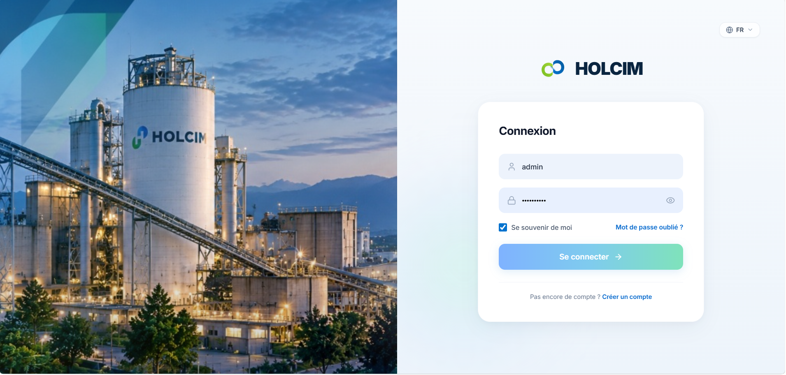

### 📊 Tableau de Bord Général
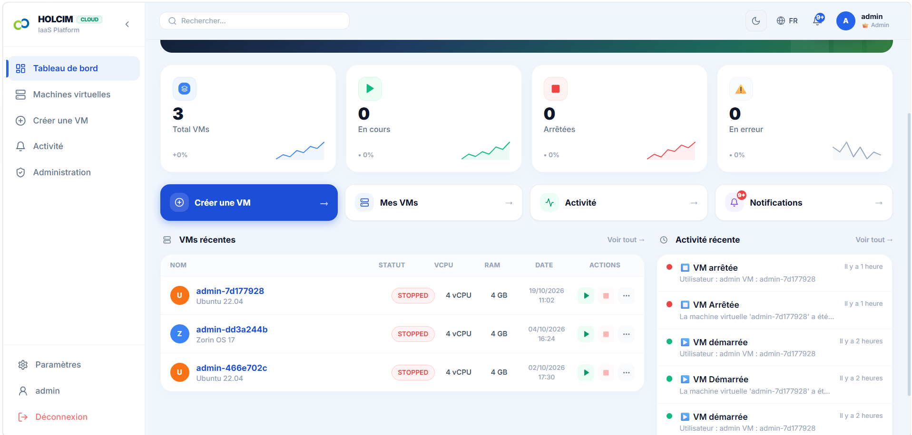

### 👤 Tableau de Bord Utilisateur
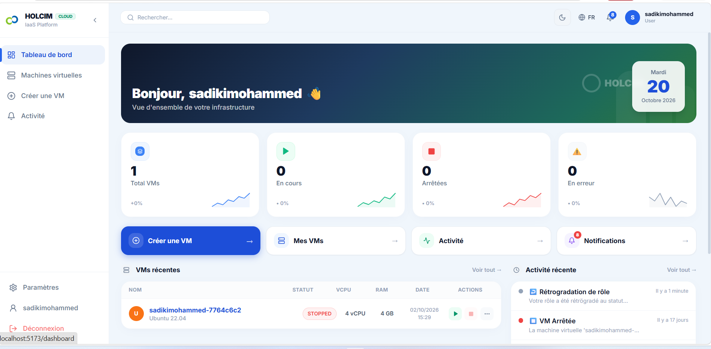

### 🌗 Mode Sombre & Multilingue
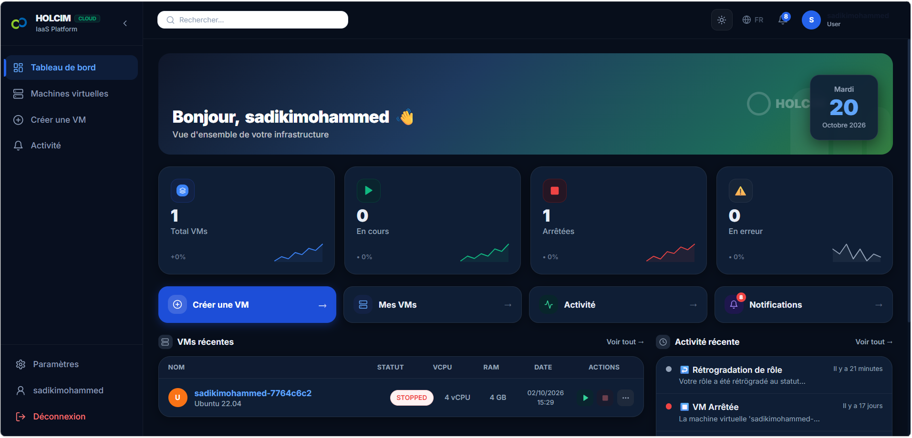

### 📱 Interface Responsive
| Vue 1 | Vue 2 |
|:---:|:---:|
| 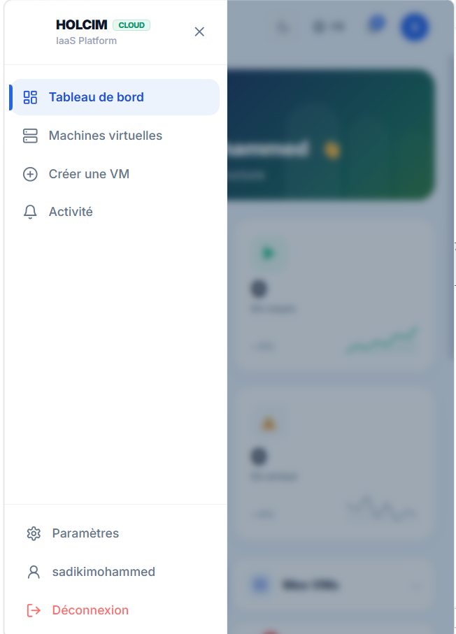 | 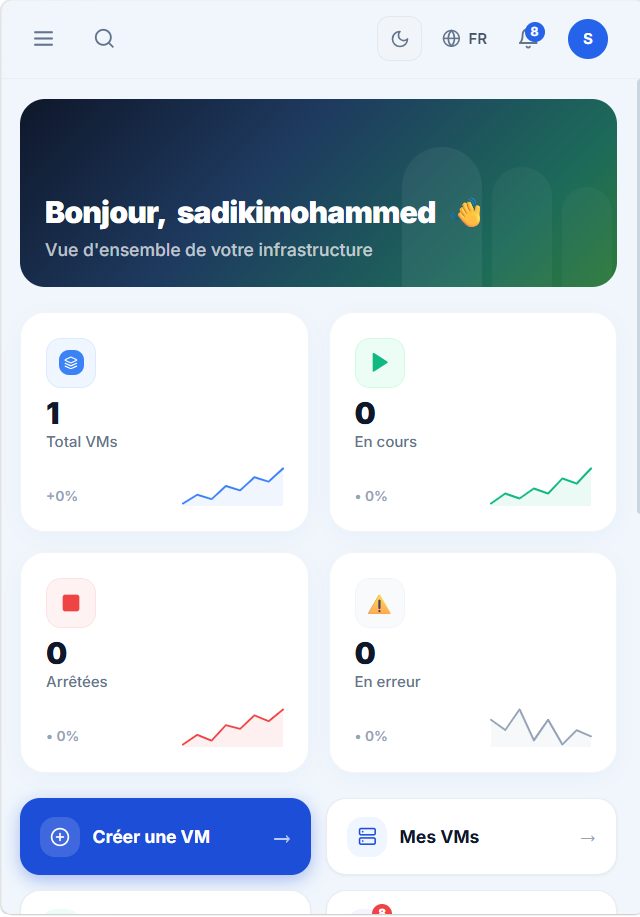 |

### 🖥️ Gestion des Machines Virtuelles
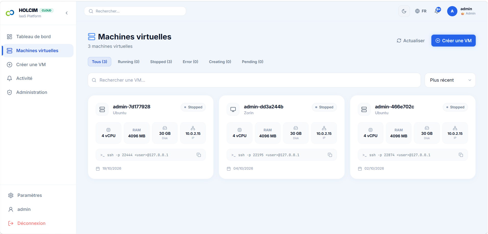

### ➕ Création d'une VM
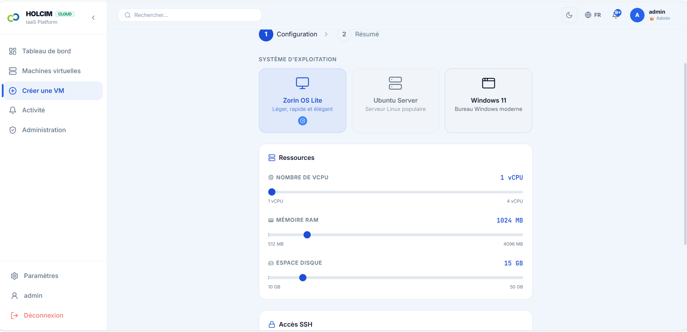

### 📋 Détail & Supervision d'une VM
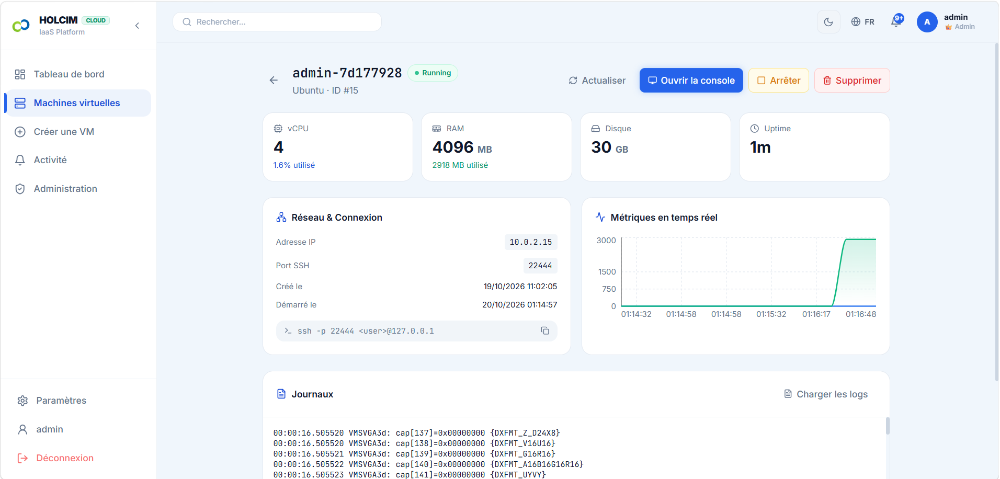

### 🖥️ Console Graphique HTML5 (Apache Guacamole)
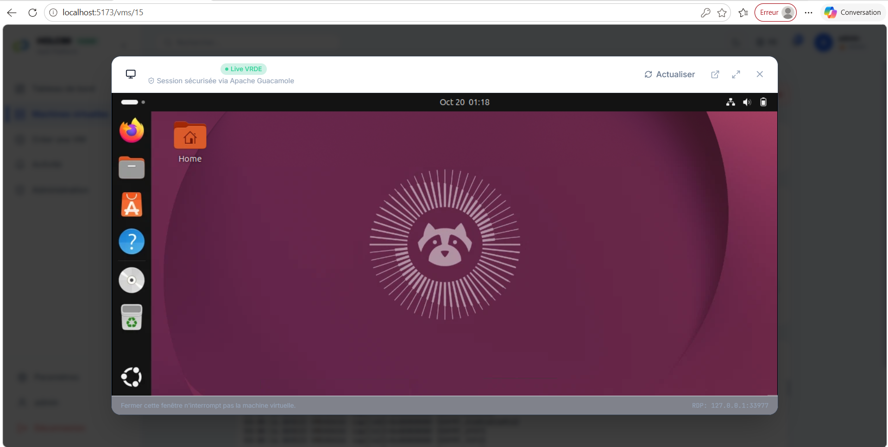

### 🔔 Centre de Notifications
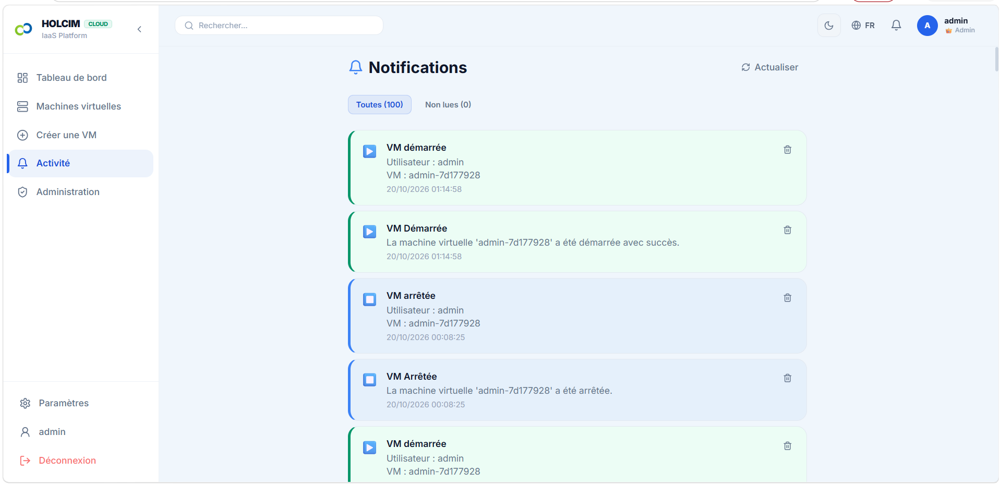

### 🛡️ Panneau Administrateur
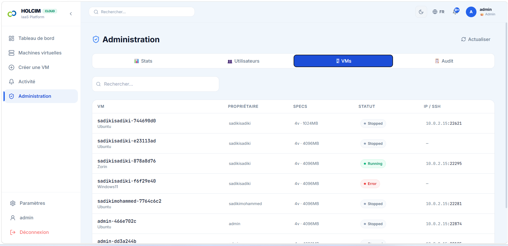

### 📜 Journaux d'Audit (Audit Trail)
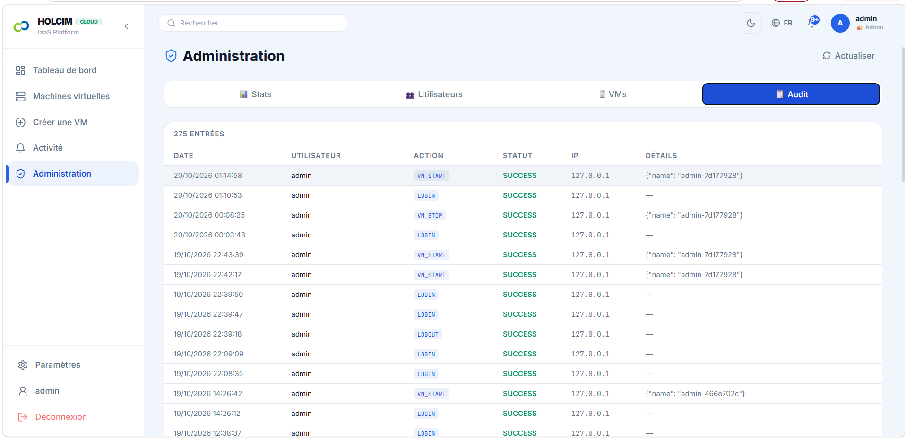

### 📖 Documentation API (Swagger / OpenAPI)
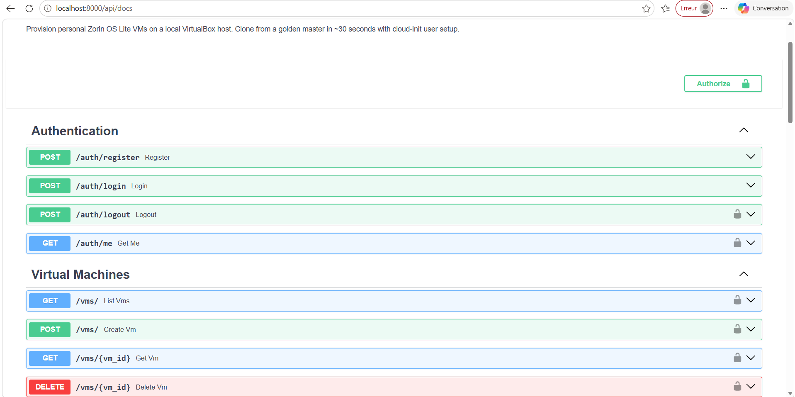

---

## ✨ Fonctionnalités

| Fonctionnalité | Description |
|---|---|
| 🚀 **Provisionnement Rapide** | Création d'une VM Zorin OS Lite en ~30 secondes par clonage du golden master |
| 🔐 **Authentification JWT** | Connexion sécurisée avec tokens JWT, rate limiting (5 tentatives / 15 min) |
| 📧 **Vérification Email** | Confirmation de compte par email (mode SMTP ou simulation) |
| 🖥️ **Console Web** | Accès à la console des VMs directement depuis le navigateur via Apache Guacamole |
| 📊 **Métriques Temps Réel** | Monitoring CPU/RAM/disque via WebSocket avec mise à jour en continu |
| 🔔 **Notifications** | Système de notifications en temps réel pour les événements VM |
| 👤 **Gestion Utilisateurs** | Interface administrateur complète : création, approbation, gestion des rôles |
| 🌐 **Multi-langue** | Support i18n intégré (Français / Anglais) |
| 🎨 **Thème Sombre/Clair** | Basculement de thème persistant |
| 🛡️ **Audit Logs** | Journalisation détaillée de toutes les actions sensibles |

---

## 🏗️ Architecture

```
ZorinVM Platform
├── 🐍 Backend (FastAPI + Python)
│   ├── API REST (auth, vms, admin, notifications)
│   ├── WebSocket temps réel (métriques VM)
│   ├── Proxy Guacamole (accès console)
│   ├── Moteur de provisionnement VirtualBox (VBoxManage)
│   └── Base de données SQLite (SQLAlchemy + Alembic)
│
└── ⚛️  Frontend (React + Vite)
    ├── Dashboard avec statistiques
    ├── Gestion des VMs (liste, détail, création)
    ├── Console VMs intégrée
    ├── Panneau d'administration
    └── Notifications & Profil utilisateur
```

---

## 🛠️ Stack Technique

### Backend
- **[FastAPI](https://fastapi.tiangolo.com)** — Framework API REST asynchrone haute performance
- **[SQLAlchemy](https://sqlalchemy.org)** + **Alembic** — ORM et migrations de base de données
- **[python-jose](https://github.com/mpdavis/python-jose)** + **passlib** — Authentification JWT sécurisée
- **[SlowAPI](https://github.com/laurentS/slowapi)** — Rate limiting (protection brute-force)
- **[VBoxManage](https://www.virtualbox.org/manual/ch08.html)** — Pilotage programmatique de VirtualBox
- **[pycdlib](https://github.com/clalancette/pycdlib)** — Génération d'images ISO cloud-init
- **WebSockets** — Streaming de métriques en temps réel

### Frontend
- **[React 18](https://reactjs.org)** + **[Vite](https://vitejs.dev)** — SPA ultra-rapide
- **[TailwindCSS](https://tailwindcss.com)** — Styles utilitaires
- **[React Router](https://reactrouter.com)** — Navigation SPA
- **[i18next](https://www.i18next.com)** — Internationalisation

---

## 🚀 Installation & Démarrage

### Prérequis

- Python **3.11+**
- Node.js **18+** & npm
- [Oracle VirtualBox](https://www.virtualbox.org/) **7.x** installé
- Un **Golden Master** Zorin OS Lite configuré avec cloud-init

### 1. Cloner le dépôt

```bash
git clone https://github.com/Mohammed-Sadiki/PFA-.git
cd PFA-
```

### 2. Configuration de l'environnement

```bash
# Copier le fichier de configuration
cp .env.example .env
```

Éditer `.env` et renseigner les variables :

```env
# Clé secrète JWT (minimum 64 caractères)
SECRET_KEY=votre-clé-secrète-très-longue-et-sécurisée

# Chemin vers VBoxManage
VBOXMANAGE_PATH=C:\Program Files\Oracle\VirtualBox\VBoxManage.exe

# Répertoires des VMs
VM_BASE_DIR=C:\VMs\vms
GOLDEN_MASTER_DIR=C:\VMs\golden-masters
CLOUD_INIT_TEMP=C:\VMs\cloud-init-temp

# Email (optionnel — mode simulation par défaut)
EMAIL_SIMULATION_MODE=true
```

### 3. Backend

```bash
# Créer l'environnement virtuel
python -m venv venv
venv\Scripts\activate          # Windows
# source venv/bin/activate     # Linux/Mac

# Installer les dépendances
pip install -r requirements.txt

# Lancer le serveur
uvicorn app.main:app --reload --host 0.0.0.0 --port 8000
```

### 4. Frontend

```bash
cd frontend

# Installer les dépendances
npm install

# Lancer en développement
npm run dev

# Ou compiler pour la production
npm run build
# Puis copier dist/ → app/static/
```

### 5. Accéder à l'application

| Service | URL |
|---|---|
| 🌐 Application Web | http://localhost:5173 (dev) |
| 📖 API Docs (Swagger) | http://localhost:8000/api/docs |
| 📘 API Redoc | http://localhost:8000/api/redoc |

---

## 📁 Structure du Projet

```
PFA-/
├── app/                        # Backend FastAPI
│   ├── main.py                 # Point d'entrée de l'application
│   ├── config.py               # Configuration (variables d'env)
│   ├── database.py             # Session SQLAlchemy
│   ├── models/                 # Modèles ORM (User, VM, ...)
│   ├── schemas/                # Schémas Pydantic (validation)
│   ├── routers/                # Routes API
│   │   ├── auth.py             # /auth/* — Authentification
│   │   ├── vms.py              # /vms/* — Gestion des VMs
│   │   ├── admin.py            # /admin/* — Administration
│   │   ├── console.py          # /console/* — Accès console
│   │   ├── notifications.py    # /notifications/*
│   │   └── ws.py               # /ws/* — WebSockets
│   ├── services/               # Logique métier
│   │   ├── vm_service.py       # Provisionnement VirtualBox
│   │   ├── metrics_service.py  # Collecte des métriques
│   │   ├── audit_service.py    # Journalisation des audits
│   │   └── websocket_manager.py
│   ├── middleware/
│   │   └── guacamole_proxy.py  # Proxy vers Apache Guacamole
│   └── static/                 # Build React (production)
│
├── frontend/                   # Frontend React + Vite
│   ├── src/
│   │   ├── pages/              # Pages de l'application
│   │   │   ├── LoginPage.jsx
│   │   │   ├── RegisterPage.jsx
│   │   │   ├── DashboardPage.jsx
│   │   │   ├── VMListPage.jsx
│   │   │   ├── VMDetailPage.jsx
│   │   │   ├── CreateVMPage.jsx
│   │   │   ├── AdminPage.jsx
│   │   │   ├── NotificationsPage.jsx
│   │   │   ├── ProfilePage.jsx
│   │   │   └── SettingsPage.jsx
│   │   ├── components/         # Composants réutilisables
│   │   ├── contexts/           # Contextes React (Auth, Theme, Notif)
│   │   ├── hooks/              # Hooks personnalisés
│   │   ├── api/                # Clients API
│   │   └── i18n/               # Traductions (fr/en)
│   └── vite.config.js
│
├── docs/
│   └── screenshots/            # Captures d'écran
├── diagrams/                   # Diagrammes d'architecture
├── requirements.txt
├── .env.example                # Template de configuration
└── setup_ubuntu.sh             # Script d'installation Linux
```

---

## 🔑 Comptes par Défaut

Après le premier démarrage, vous pouvez créer un compte via `/register`.  
Pour réinitialiser les mots de passe en développement :

```bash
python reset_user_passwords.py
```

---

## 🔒 Sécurité

- **Rate Limiting** : 5 tentatives de connexion max par 15 minutes
- **JWT** : Tokens signés avec algorithme HS256, expiration configurable
- **Hachage** : Mots de passe hashés avec bcrypt
- **Audit Trail** : Toutes les actions sensibles sont journalisées
- **CORS** : Configurer `allow_origins` en production

---

## 🤝 Contribution

Les contributions sont les bienvenues !

```bash
# Créer une branche
git checkout -b feature/ma-fonctionnalite

# Commiter vos changements
git commit -m "feat: ajout de ma fonctionnalité"

# Pousser et ouvrir une Pull Request
git push origin feature/ma-fonctionnalite
```

---

## 📄 Licence

Ce projet est sous licence **MIT**. Voir le fichier [LICENSE](LICENSE) pour plus de détails.

---

<div align="center">

**Réalisé dans le cadre du Projet de Fin d'Année (PFA) — Holcim Maroc**

[](https://fastapi.tiangolo.com)
[](https://reactjs.org)
[](https://virtualbox.org)

</div>
